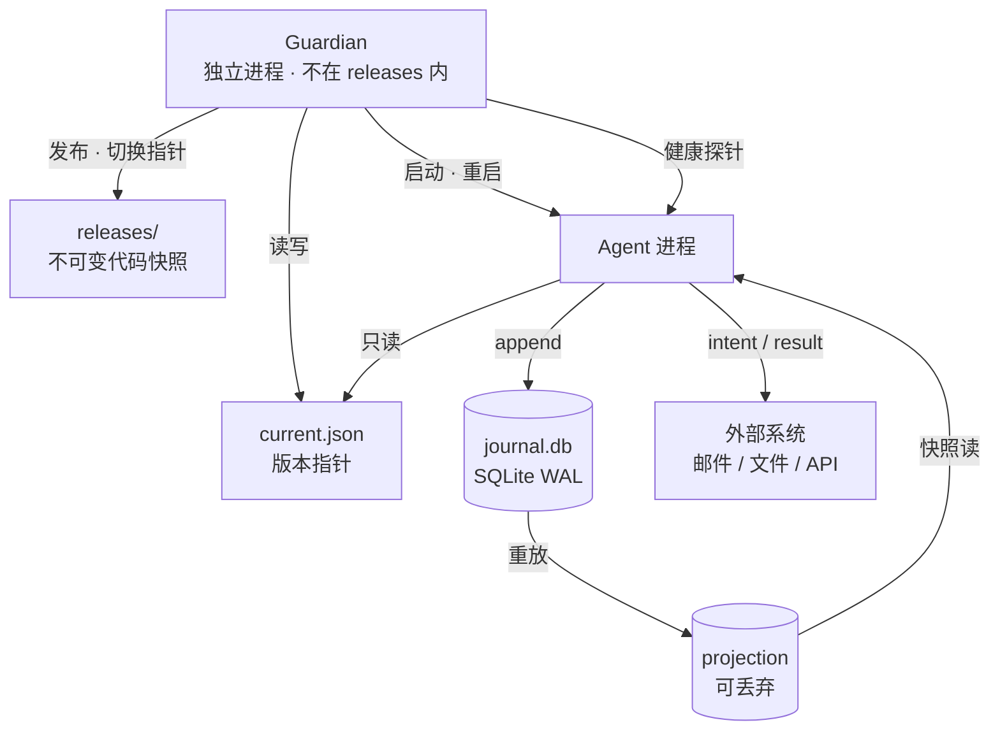

# PRD：自愈式 Agent 运行时（Hot-Standby Runtime）

| 项 | 内容 |
|---|---|
| 文档版本 | v0.1（Draft） |
| 日期 | 2026-11-15 |
| 状态 | 待评审 |
| 一句话 | 让一个会改自己代码的 agent，在改坏自己的时候能在 30 秒内自动退回上一个已知可用版本，并且状态不受损、外部副作用不重复。 |

---

## 1. 背景与问题

### 1.1 现象

Agent 具备修改自身代码或提示词的能力后，会出现一类必然的失效：**它把运行在生产的自己改坏了**。此时没有可信的退路——旧代码已经被覆盖，进程起不来，日志只剩半截，状态不知道该算哪个版本。

### 1.2 三个独立的失效面

必须分开处理。把它们混成一个"备份"概念，是现有方案普遍失效的根因。

| 失效面 | 表现 | 直觉方案 | 为什么不够 |
|---|---|---|---|
| **代码失效** | 改完 import 就崩、语法错、逻辑死循环 | 备份一份旧代码 | 备份不知道哪份是"好的"，也没有切换机制 |
| **状态失效** | 状态被新逻辑写乱，旧代码读不懂 | 备份数据库 | 备份是某个时刻的快照，不知道对应哪版代码 |
| **副作用已发生** | 消息已发、文件已删、款已付 | 回滚数据库 | 外部世界不会跟着回滚 |

### 1.3 被排除的方案

**两个实例互为热备**（双活）：两个实例跑的是同一份代码，代码坏了两个一起坏。它解决的是进程存活，不是代码回滚。真正有价值的"两个实例"形态是**蓝绿**——一个跑 current，一个跑候选版做验证。

**进程内热替换代码**（`importlib.reload` / 类重定义）：对长生命周期、持有大量实例和闭包的对象不可靠。本方案明确以**重启进程**为唯一生效手段。

---

## 2. 目标与非目标

### 2.1 目标

| 编号 | 目标 | 衡量方式 |
|---|---|---|
| G1 | 代码版本不可变，切换是原子的 | 切换操作是单次文件替换，无中间态 |
| G2 | 回滚不依赖人工判断，能自动发生 | 冒烟失败或观察期内健康信号恶化，自动退回 |
| G3 | 状态从进程剥离，可从日志完整重建 | 删除投影后重放，校验和一致 |
| G4 | 外部副作用不重复、不漏单 | 崩溃后未决意图全部可对账 |
| G5 | 旧代码能读新代码写的账 | 未知事件不崩、不猜，进隔离队列 |

### 2.2 非目标

- **不做多机高可用**。单机单写者，不做分布式选主。
- **不做进程内热升级**。不做两版本代码同时在内存里共存。
- **不做分布式事务**。外部副作用靠幂等键与对账，不做两阶段提交。
- **不做多租户**。一个实例一套账本。
- **不做通用 CQRS 框架**。只实现本 PRD 列出的能力，不引入聚合根、命令总线、Saga 框架。

---

## 3. 核心概念

| 术语 | 定义 |
|---|---|
| **LSN / seq** | 日志全局单调序号，由 SQLite `AUTOINCREMENT` 保证永不复用 |
| **agent_ver** | 写入该条日志的代码版本，如 `v42` |
| **schema_ver** | 该条日志的事件结构版本，只增不改 |
| **intent** | 声明"即将执行某外部副作用"，带幂等键 |
| **result** | 该副作用的实际结果：`ok` / `fail` / `unknown` |
| **fact** | 从外部观察到的事实，不可变 |
| **decision** | Agent 做出的判断，必须带 policy 版本 |
| **projection** | 从日志推导出的读模型，**可随时丢弃重建** |
| **quarantine** | 旧代码无法解释的事件，隔离待人工处理 |
| **guardian** | 独立进程，负责启停、探针、切换指针 |
| **release** | `releases/<ver>/` 下一份不可变的代码快照 |

---

## 4. 系统架构

### 4.1 组件



四层职责：

1. **Guardian（守护层）**：唯一有权改指针、启停 agent 的组件。代码独立存放，不参与 agent 的自我修改。
2. **Release Store（版本层）**：只追加不覆盖的代码快照目录，agent 只读。
3. **Agent Process（执行层）**：真正干活的部分，可被杀死、可被替换。
4. **Journal（账本层）**：状态的唯一真相，只追加。

### 4.2 权限边界（关键）

这是整套设计能否成立的前提。**权限矩阵错了，回滚机制会跟着被改坏。**

| 组件 | 工作区代码 | `releases/` | `journal.db` | `current.json` |
|---|---|---|---|---|
| Agent | 读写 | 只读 | **只能 append** | 只读 |
| Guardian | **只读** | 写（发布） | 只读 | 读写 |

落地方式（按强度递增，至少做到前两条）：

1. 目录层面分离：guardian 与 `releases/` 不在 agent 的工作目录下
2. 文件权限：`releases/` 与 `journal.db` 对 agent 的运行账号设为只读（append 通过 guardian 提供的窄接口，或使用独立连接只开 `INSERT` 权限的表）
3. 进程隔离：guardian 跑在独立容器 / 独立系统用户下

### 4.3 两个独立的轴

- **横轴：日志位置（LSN）**——读取哪个时刻的状态
- **纵轴：代码版本（agent_ver）**——用哪份代码解释状态

回滚是换纵轴，时间旅行是换横轴。两者正交，才能做到"代码退回去，状态不动"。但要注意一个泄漏：**日志记的是事实，"事实意味着什么"是代码算的**。这条泄漏由 FR-9（未知事件隔离）兜住。

---

## 5. 功能需求

### FR-1 Release 管理

**描述**：每次代码变更产出一个不可变目录 `releases/<ver>/`，`ver` 单调递增（`v42`、`v43`），目录一旦写入不得修改。

**要求**
- 发布流程写入完整代码快照 + 依赖锁文件（`requirements.lock` 或 `uv.lock`）
- 发布前校验：`selftest.py` 存在且可执行
- 目录写入完成后置为只读

**验收**：对 `releases/v42/` 下任意文件尝试写入，必须失败。

---

### FR-2 原子切换

**描述**：`current.json` 存 `{"version": "v42", "since": "..."}`。切换通过写临时文件 + `os.replace` 完成，读方永远看到完整 JSON。

**要求**
- 不得在切换过程中出现文件为空或半个 JSON 的中间态
- 切换动作**不触发**重启，由 guardian 在切换后显式重启 agent

**验收**：在 100 次并发读的下压测试中切换 1000 次，无一次读到非法内容。

---

### FR-3 健康门禁与自动回退

**描述**：guardian 启动 agent 后持续采集健康信号，任一硬信号失败立即回退。

**信号定义**

| 编号 | 信号 | 类型 | 判据 |
|---|---|---|---|
| H1 | 进程存活 | 硬 | 进程在且心跳文件更新间隔 < 5s |
| H2 | 启动自检 | 硬 | `selftest.py` 退出码 0，超时 20s 视为失败 |
| H3 | 任务成功率 | 软 | 观察期内成功率 ≥ 阈值，且样本量 ≥ 5 |
| H4 | 异常频率 | 软 | 未捕获异常条数不超阈值 |
| H5 | 账本可写 | 硬 | 一次 `BEGIN; INSERT; ROLLBACK` 试写成功 |

**观察期**：切换后默认进入 10 分钟（或 N 个任务，取先到者）。观察期内出现硬信号失败 → 立即回退；软信号不达标 → 观察期结束时回退；全部通过 → 版本标记为 `known_good`。

**回退动作**（三步，不做第四步）
1. `current.json` 指回 `last_known_good`
2. 重启 agent
3. **不截断、不回滚 journal**

**验收**
- 发布一个 `import` 即崩溃的版本，从发布到完成回退总耗时 < 30s
- 回退后 `journal.seq` 保持单调，不回退、不缺口

---

### FR-4 日志追加

**描述**：所有状态变更以事件形式追加到 `journal`，只追加，不更新、不删除。

**要求**
- 每次追加必须记录 `agent_ver` 与 `schema_ver`
- `payload` 必须是合法 JSON
- 事件结构**只允许新增字段**，不改名、不删除、不改语义
- 单次追加在事务内完成，与其他写操作原子

**验收**：table 上不允许出现 `UPDATE` / `DELETE`（由代码层禁用 + 事后校验脚本双保险）。

---

### FR-5 快照读与重放

**描述**：提供两个基础能力。

- **快照读**：`SELECT ... WHERE seq <= :lsn`，得到该时刻的完整状态
- **增量重放**：`SELECT ... WHERE seq > :lsn ORDER BY seq`，从检查点继续

**要求**
- 读事务内的一致性由 SQLite WAL 保证，长任务重放不被写入阻塞
- 重放必须幂等：同一区间重放两次，结果一致

**验收**：10 万条事件增量重放耗时 < 10s。

---

### FR-6 投影与可丢弃性

**描述**：读模型（projection）从日志推导，**必须可以整表删除后从 `seq=0` 重建**。

**要求**
- `projection_meta` 记录 `last_seq`、构建者 `agent_ver`、内容校验和
- 提供 `rebuild` 命令：清空 → 全量重放 → 比对校验和
- 校验和不一致视为严重故障，阻塞启动

**验收（这是本 PRD 最重要的一条）**：删除投影表 → `rebuild` → 校验和与删除前一致。

> 这条测试过不了，说明权威状态被偷偷放进了投影，CQRS 已经开始腐化。

---

### FR-7 外部副作用：意图 / 结果配对

**描述**：所有外部副作用必须先写 `intent`，执行后写 `result`，两者用 `idem_key` 关联。

**要求**
- `idem_key` 全局唯一（唯一索引），同一操作重试必须复用同一个键
- `result` 记录外部系统的实际返回：`ok` / `fail` / `unknown`
- `unknown` 是合法结果，表示"调用发出了但结果没拿到"，不得猜测成 `ok` 或 `fail`

**验收**：同一 `idem_key` 重复追加 `intent` 时被唯一索引拒绝，不产生第二条意图。

---

### FR-8 未决意图对账

**描述**：进程崩溃后重启时，扫描"有 intent 无 result"的记录，进入待对账队列。

**要求**
- **禁止**直接重试（会重复执行）
- **禁止**当作未发生（会漏单）
- 必须用 `idem_key` 向外部系统查询真实状态，再补写 `result`
- 对账失败的意图进入人工队列，阻塞依赖它的后续任务

**验收**：模拟 `intent` 写入后 `kill -9`，重启后该意图出现在待对账队列，且未被自动执行。

---

### FR-9 未知事件隔离

**描述**：旧代码读到新代码写入的、自己不认识的 `kind` 或字段时，不崩溃、不猜测，写入 `quarantine`。

**要求**
- 解析失败的事件被跳过，其余事件正常处理
- `quarantine` 记录 `seq`、原因、时间、是否已处理
- 存在未处理隔离事件时，健康信号标记为 `degraded`，但不触发回退

**验收**：用 v41 代码重放包含 v42 独有字段的事件，重放不抛异常，事件进入隔离表。

---

### FR-10 备份与恢复

**描述**：账本是权威数据，必须有独立于进程的备份路径。

**要求**
- 备份使用 `VACUUM INTO` 或官方 backup API，**不得直接复制 `.db` 文件**（WAL 未 checkpoint 时会丢尾部）
- 启动自检：库文件路径若位于同步目录（OneDrive / Dropbox / iCloud）或网络盘，**拒绝启动并告警**
- 可选接入 Litestream 做持续复制

**验收**：在 WAL 有未 checkpoint 内容时做一次备份，恢复到新路径后能完整重放，结尾 `seq` 一致。

---

## 6. 数据模型

```sql
PRAGMA journal_mode   = WAL;
PRAGMA synchronous    = FULL;
PRAGMA busy_timeout   = 5000;

CREATE TABLE journal (
  seq        INTEGER PRIMARY KEY AUTOINCREMENT,   -- AUTOINCREMENT 保证 seq 永不复用
  ts         TEXT    NOT NULL,                    -- ISO8601 UTC
  kind       TEXT    NOT NULL
             CHECK (kind IN ('intent','result','fact','decision')),
  agent_ver  TEXT    NOT NULL,
  schema_ver INTEGER NOT NULL DEFAULT 1,
  idem_key   TEXT,
  payload    TEXT    NOT NULL
);
CREATE INDEX ix_journal_kind_seq ON journal(kind, seq);
CREATE UNIQUE INDEX ux_journal_idem
  ON journal(idem_key) WHERE idem_key IS NOT NULL;

CREATE TABLE projection_meta (
  name       TEXT PRIMARY KEY,
  last_seq   INTEGER NOT NULL,
  checksum   TEXT NOT NULL,
  built_by   TEXT NOT NULL,
  built_at   TEXT NOT NULL
);

CREATE TABLE quarantine (
  seq        INTEGER PRIMARY KEY REFERENCES journal(seq),
  reason     TEXT NOT NULL,
  raised_at  TEXT NOT NULL,
  resolved   INTEGER NOT NULL DEFAULT 0
);

CREATE TABLE runtime_beat (          -- 心跳独立，不污染 journal
  id         INTEGER PRIMARY KEY CHECK (id = 1),
  pid        INTEGER NOT NULL,
  agent_ver  TEXT    NOT NULL,
  beat_at    TEXT    NOT NULL
);
```

**设计说明**

- `AUTOINCREMENT` 不可省。默认 rowid 在删除后会复用，对账本来说是致命的。
- 心跳单独建表。心跳写进 `journal` 会让重放变成噪声，且破坏"只追加业务事实"的语义。
- 不删除 `journal` 行。归档走独立归档库或分段文件。
- `json_valid()` 校验视 SQLite 版本可用性启用（3.38+ 默认带 JSON1），启动时探测。

---

## 7. 关键流程

### 7.1 发布新版本

1. Agent 在**工作区**完成自修改（不直接改 `releases/`）
2. Guardian 收到发布请求 → 创建 `releases/<ver>/` 快照 → 置只读
3. Guardian 跑 `selftest.py`（20s 超时）
4. 自检失败 → 归档该版本为 `failed`，**不切指针**，流程结束
5. 自检通过 → 写指针 → 重启 agent → 进入观察期
6. 观察期通过 → 标记 `known_good`；失败 → 执行 FR-3 回退

### 7.2 自动回退

1. 硬信号失败（H1/H2/H5）→ 立即触发
2. 读取 `last_known_good`
3. `os.replace` 切指针
4. 重启 agent
5. 记录 `decision` 事件：`{"rollback_from": "v43", "rollback_to": "v42", "trigger": "H2"}`

### 7.3 崩溃恢复

1. Guardian 拉起 agent
2. Agent 读指针 → 加载对应 release
3. 查未决意图 → 有则进入对账流程（FR-8），**不进入正常任务循环**
4. 校验投影校验和 → 不一致则重建
5. 检查隔离队列 → 有未处理项则标记 `degraded`
6. 进入就绪状态

---

## 8. 非功能需求

| 类别 | 要求 |
|---|---|
| 追加性能 | p99 < 5ms |
| 重放性能 | 10 万条 < 10s |
| 投影重建 | 10 万条 < 30s |
| 持久性 | `synchronous=FULL`；已提交事件在进程被杀后不丢 |
| 可观测 | 每次切换/回退/对账都产出一条 `decision` 事件；人类日志（structlog）带 `agent_ver` 与 `seq` |
| 可移植 | 单机 SQLite 迁移到 Postgres 时，仅改连接与少量方言，不被框架绑定 |
| 安全 | `releases/` 与 `journal.db` 对 agent 只读；guardian 代码不参与自我修改 |

---

## 9. 验收清单（DoD）

- [ ] AC-1 杀掉 agent 进程，guardian 在 3s 内拉起
- [ ] AC-2 发布 `import` 即崩的版本，30s 内自动回退完成
- [ ] AC-3 删除投影 → 全量重放 → 校验和一致
- [ ] AC-4 `intent` 写入后 `kill -9`，重启后进入对账队列且未重复执行
- [ ] AC-5 v41 代码重放含 v42 独有字段事件，不抛异常且进入隔离表
- [ ] AC-6 回退后 `seq` 单调、无缺口、不截断
- [ ] AC-7 `journal.db` 拷到另一台机器可正常重放
- [ ] AC-8 WAL 有未 checkpoint 内容时备份，恢复后 `seq` 一致
- [ ] AC-9 `releases/` 下文件对 agent 只读
- [ ] AC-10 库文件位于同步目录时启动被拒绝

---

## 10. 里程碑

| 阶段 | 范围 | 交付物 |
|---|---|---|
| **M0** | 账本 | `journal.py`（append / 快照读 / 重放）、DDL、校验和。跑通"写入 → 回放 → 校验和一致" |
| **M1** | 版本 | `releases/` + 指针 + guardian 拉起与自动回退。跑通 AC-1 / AC-2 / AC-6 / AC-9 |
| **M2** | 一致性 | intent / result 配对、对账、隔离队列。跑通 AC-4 / AC-5 |
| **M3** | 运维 | 备份、Litestream、启动自检、可观测。跑通 AC-8 / AC-10 |

M0 是硬前置：**账本没有跑通就不该开始写 guardian**，否则回滚没有可信落点。

---

## 11. 风险与对策

| 风险 | 影响 | 对策 |
|---|---|---|
| Guardian 自身被 agent 改坏 | 回滚能力消失 | 权限隔离 + guardian 独立于 `releases/`（4.2 节） |
| 投影腐化（权威状态混入投影） | 回放不可信 | FR-6 可丢弃性测试，每次启动校验和 |
| 事件 schema 漂移 | 旧代码读不懂新账 | 只增不改 + `schema_ver` + FR-9 隔离 |
| 未决意图被误重试 | 重复扣款 / 重复发送 | `idem_key` 唯一索引 + 强制对账（FR-8） |
| 库文件放同步盘 | 数据库损坏 | 启动路径自检，拒绝启动 |
| 磁盘写满 | 追加失败，日志出现空洞 | 预留空间 + 阈值告警 + 追加失败即停任务 |

---

## 12. 开放问题

1. **投影是否需要按代码版本重建？** v41 与 v43 对同一事件可能有不同解释。选项：(a) 投影只存事实不做解释；(b) 投影标记 `built_by`，回退后按需重建。倾向 (a)，需验证。
2. **`decision` 事件是否参与重算？** 若参与，回滚后历史决策会被新逻辑改写；若不参与，决策逻辑修复对历史无效。倾向记录但不重算。
3. **多实例写者选举**：当前明确非目标，若将来需要，是切 Postgres 还是做单写者代理。
4. **观察期长度是否应按任务类型自适应**：当前固定 10 分钟，可能对低频 agent 过短、对高频 agent 过长。
